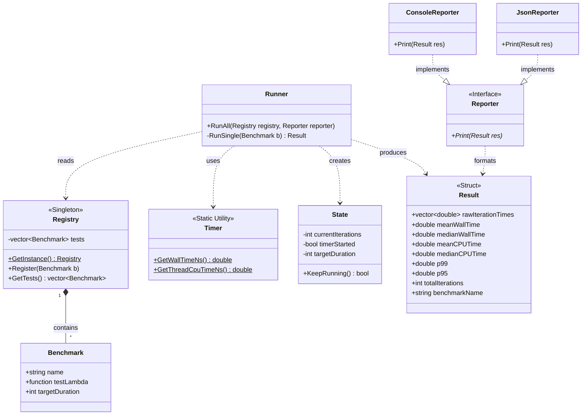

# Micro-benchmarking Suite
The purpose of this product is to serve as a latency benchmarking suite for various implementations. The remainder of this document will breakdown the system design steps. 

## Functional Requirements
1. The system MUST allow the user to time the execution of their code; wall time and CPU time. 
2. The system MUST mitigate the impact of background processes and other operating system specific actions do not affect the reported execution time. 
3. The system MUST minimize compiler optimization or other such behavior that can affect the reported execution time. 
4. The system MUST allow the user to choose the benchmarking duration.
5. The system MUST provide the user with number of iterations completed in the assigned time. 
6. The system MUST provide the user with metrics such as percentiles, mean, median, maximum values. 
7. The system MUST allow the user to test their function/code without needing to write extensive boilerplate. 
8. The system MUST provide hooks to initialize data before the timer starts, and clean it up after, ensuring that this time is not included in the benchmark data itself. 
9. The system MUST run the target function a certain number of times before starting the clock to allow for CPU cache warm-up.
10. The system MUST format the calculated metrics into a human-readable console output.  

## Non-functional Requirements (Quality)
1. The system MUST use the highest-resolution monotonic clock provided by the host operating system and hardware. Monotonic clocks ensure that there is no fluctuation in the timing since wall clock is dependent on the OS syncing with the internet atomic clocks.
2. The system MUST be able to separate thread CPU time from real time. So, if the OS pauses the benchmark to run a background process the system should know how to account for this.  
3. The system MUST ensure that its own internal workings such as timer checks, loop increments consume near-zero CPU cycles.

## Pending Requirements (To do)
1. FR-3: prevent compiler optimizations from stripping away benchmark logic
2. FR-8: provide hooks to initialize and clean up data outside of the timed loop
3. Fix build instructions
4. Add section for "Why not Google Benchmark"

## Core Entities
- Registry: singleton class with a Macro
- Benchmark: main data container
- State: track actual loop data while benchmark test runs, i.e. track time elapsed, number of iterations
- Timer: wrapper class to abstractly use OS specific APIs for wall time and CPU time 
- Runner: runs the actual loop
- Result: struct for all computed values and data
- Reporter: abstract base class with virtual methods which can be inherited from in various reporter formats like ConsoleReporter, JSONReporter etc. 

